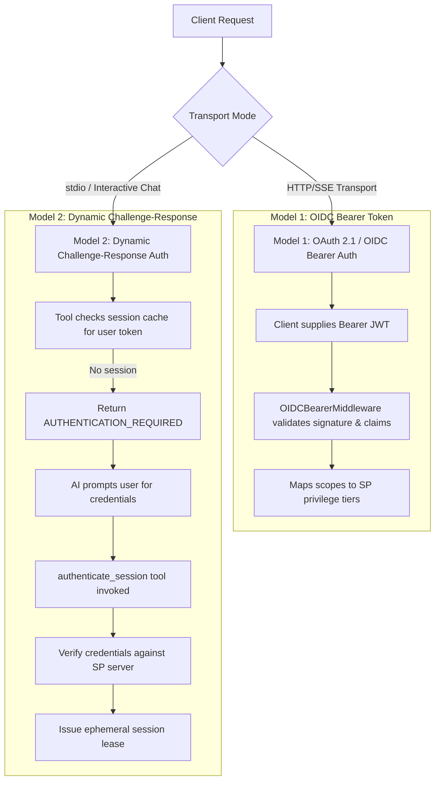
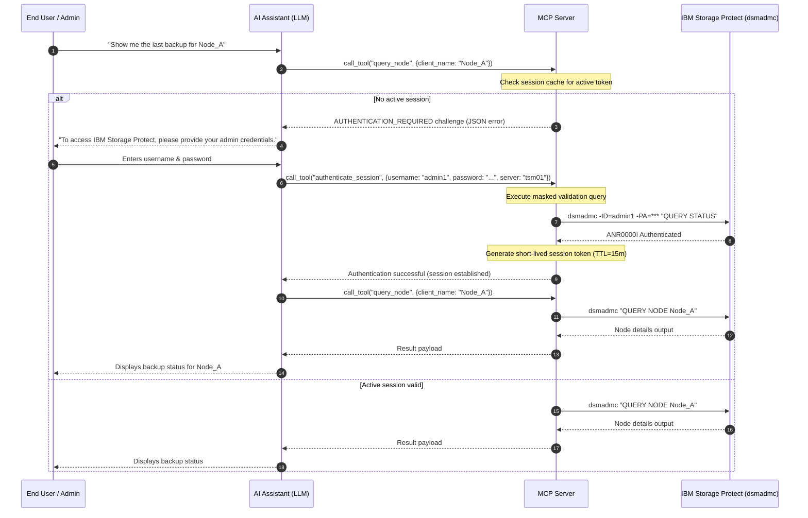

# Dynamic & Delegated User Authentication Design Analysis

* **Revision**: 2026-11 (Post-Audit Remediation — DAUTH-10 Multi-Client Transport Isolation, Dual-Identity Audit Trail, AUD-07, AUD-08, DAUTH-7 Closed)
* **Domain**: Identity, Credentials & Delegated Authentication
* **Design Reference**: [`docs/design/security-dynamic-authn.md`](../design/security-dynamic-authn.md)
* **Implementation Reference**: [`docs/implement/impl-security-dynamic-authn.md`](../implement/impl-security-dynamic-authn.md)
* **Cross-reference**: [`docs/analysis/security-design-analysis.md`](security-design-analysis.md) · [`docs/design/security-identity-credentials.md`](../design/security-identity-credentials.md) · [`docs/design/security-integrations.md`](../design/security-integrations.md) · [`docs/design/security-non-repudiation.md`](../design/security-non-repudiation.md)
* **Source reference**: `src/sp_mcp_server/` · `src/sp_mcp_server/mcp_factory.py` · `src/sp_mcp_server/http_server.py` · `src/sp_mcp_server/session.py` · `src/sp_mcp_server/commands/system/auth.py` · `src/sp_mcp_server/cli_wrapper.py`
* **IBM Storage Protect Reference**: [`docs/reference/b_srv_admin_ref_linux.pdf`](../reference/b_srv_admin_ref_linux.pdf) (v8.1.26 Linux)

---

## 1. Overview & Context

In interactive AI assistant environments (such as Claude Desktop, OpenWebUI, or custom chat interfaces), AI agents operate on behalf of human users. Because LLMs cannot securely store persistent plaintext credentials, the Model Context Protocol (MCP) server must act as a secure, stateful gateway.

This document specifies the architecture for **Dynamic & Delegated Authentication (Challenge-Response)**, allowing the MCP server to dynamically challenge chat users for credentials, validate credentials against IBM Storage Protect (`dsmadmc`), establish ephemeral session leases, and support OAuth 2.1 / OIDC token-based delegated authorization.

---

## 2. Authentication Models

The IBM Storage Protect MCP Server supports two complementary authentication models:



### 2.1 Multi-Client Transport Isolation Requirements (HTTP/SSE) — DAUTH-10

A critical architectural distinction exists between transport modes regarding state isolation and concurrency:

1. **`stdio` Transport (Single-Tenant Local Process)**:
   * The MCP server executes as a dedicated child process spawned by a single client application (e.g., Claude Desktop).
   * Process memory is private to that single client.
   * State isolation within the process is managed via asynchronous task-scoped context variables (`contextvars.ContextVar`).

2. **`HTTP/SSE` Transport (Multi-Tenant Shared Daemon)**:
   * The MCP server runs as a long-lived network service (`--transport http`), accepting concurrent Server-Sent Events (SSE) connections and HTTP POST messages from multiple distinct clients.
   * **Strict Elimination of Process Globals:** Module-level global variables (such as `_process_session_id`, `_process_audit_user`) are strictly prohibited for storing client lease or identity state. Shared global state causes cross-client credential bleeding and session hijacking across concurrent network streams (`DAUTH-10`).
   * **Mandatory Cryptographic Principal & Connection Binding (`DAUTH-10`)**:
     * Every ephemeral `SessionLease` created over network transports must record:
       1. `oidc_subject`: The cryptographically validated OIDC `sub` claim extracted by `OIDCBearerMiddleware`.
       2. `connection_id`: The unique transport connection / SSE stream identifier assigned during connection initialization.
       3. `transport_mode`: Explicitly marked as `"http"` or `"stdio"`.
     * **Invocation-Time Enforcement:** Before executing any tool using a delegated lease, the server interceptor verifies that the lease's `oidc_subject` matches the active caller's `request.state.mcp_subject`. If a cross-client session reuse attempt is detected, execution is immediately aborted with `AUTHORIZATION_DENIED`.

---

## 3. Dynamic Challenge-Response Workflow

### 3.1 Stateful Session Verification in MCP Tools
Every administrative tool verifying end-user access checks for an active session context prior to executing commands against the IBM Storage Protect server.



---

## 4. Standardized Challenge Schema

When authentication or step-up verification is required, the tool responds with a structured `AUTHENTICATION_REQUIRED` challenge:

```json
{
  "is_error": true,
  "error_type": "AUTHENTICATION_REQUIRED",
  "message": "Authentication required. Please provide your IBM Storage Protect administrator credentials.",
  "challenge": {
    "server": "tsm_server_01",
    "required_fields": ["username", "password"],
    "supported_schemes": ["basic_delegated", "oidc_bearer"],
    "auth_tool": "authenticate_session"
  }
}
```

---

## 5. Dedicated Authentication Tools

### 5.1 `authenticate_session` Tool Specification
* **Name**: `authenticate_session`
* **Privilege Tier**: `any`
* **Input Schema**:
  * `username` (string, required): IBM Storage Protect administrator ID.
  * `password` (string, required): Administrator password.
  * `target_server` (string, optional): Target SP server instance if multi-server routing is active.
* **Execution & Verification**:
  1. The MCP server executes a lightweight, silent test command (e.g., `QUERY STATUS`) using `DsmAdmcWrapper.execute_silent()` to verify credentials without leaking passwords to local logs.
  2. Upon successful authentication (`returncode == 0`), an ephemeral in-memory session lease with a configurable Time-To-Live (TTL) is minted.
  3. The lease records the caller's OIDC identity (`oidc_subject`), the current transport connection ID (`connection_id`), and transport mode (`stdio` or `http`) to enforce transport isolation (`DAUTH-10`).
  4. The lease token is associated with the calling task context via request-scoped `current_session_id` and `current_audit_user` `ContextVar`s. Storing session state in process globals is strictly prohibited.

### 5.2 `logout_session` Tool Specification
* **Name**: `logout_session`
* **Privilege Tier**: `any`
* **Input Schema**:
  * `session_id` (string, optional): Specific session lease identifier to revoke. If omitted, resolves from the active task context or connection ID.
* **Execution & Verification**:
  1. Resolves the target session ID from arguments, task context variable (`current_session_id`), or transport connection mapping.
  2. Performs anti-IDOR caller ownership validation: verifies that the session belongs to the calling OIDC subject before revoking. Cross-client revocation attempts are rejected with `AUTHORIZATION_DENIED`.
  3. Calls `SessionManager.revoke_session()`, which immediately zeroes `SessionLease.password` (AUD-08) and removes the lease from in-memory cache.
  4. Clears active context variables (`current_session_id`, `current_audit_user`).

---

## 6. End-to-End Workflow Matrix

| Step | Component | Action | Forensic / Security Note |
|:---:|:---|:---|:---|
| **1** | **User** | Requests administrative action (e.g., `"Restore client data"`). | Human intent expressed in chat. |
| **2** | **AI Agent** | Dispatches MCP tool call `restore_client_data(...)`. | Tool parameters structured. |
| **3** | **MCP Server** | Resolves session lease (Arg → ContextVar → Connection ID) and validates lease existence. | Inverted lease resolution precedence. |
| **4** | **MCP Server** | Returns `AUTHENTICATION_REQUIRED` response if no active lease exists. | No credential leakage. |
| **5** | **AI Agent** | Prompts user: `"Please enter your IBM Storage Protect administrator credentials."` | Clear prompt for authentication. |
| **6** | **User** | Provides credentials in client UI. | UI handles input masking if supported. |
| **7** | **AI Agent** | Calls `authenticate_session(username="...", password="...")`. | Dedicated auth tool. |
| **8** | **MCP Server** | Validates via `dsmadmc execute_silent()`, caches lease with `oidc_subject` & `connection_id`, sets contextvars. | Zero-trace credential verification, connection-scoped lease. |
| **9** | **AI Agent** | Retries original administrative tool call automatically. | Seamless execution resumption. |
| **10** | **MCP Server** | Verifies OIDC subject (`DAUTH-10`), target server (`DAUTH-7`), tool privilege; emits compound audit (`POL-4`/`NR-1`). | Dual-identity attribution: `oidc_user` + `sp_admin`. |
| **11** | **User** | Concludes session and calls `logout_session()`. | Session revoked, credentials zeroed in memory (AUD-08). |

---

## 7. Security Hardening & Best Practices

1. **Short-Lived Ephemeral Sessions**:
   - In-memory session leases have a strict sliding inactivity timeout (default: 15 minutes, `SP_MCP_SESSION_TTL`) and an absolute maximum (`SP_MCP_SESSION_MAX_TTL`, default 60 minutes).
   - Sessions are discarded on server restart, explicit `revoke_session()` call, `cleanup_expired()`, or user-initiated `logout_session` tool invocation.
   - `SessionManager` uses `RLock` to synchronize all create/get/revoke/cleanup/clear operations.
   - Each `SessionLease` record tracks `oidc_subject`, `connection_id`, and `transport_mode` for multi-client transport scoping.

2. **Zero-Trace Credential Handling (AUD-08)**:
   - All credential validation commands use [`DsmAdmcWrapper.execute_silent()`](../../src/sp_mcp_server/cli_wrapper.py). The command string and credentials are never written to any log handler.
   - `SessionLease.password` is set to `None` on every removal path — `revoke_session()`, expiry in `get_session()`, bulk `cleanup_expired()`, and `clear()` at shutdown.
   - The `logout_session` tool provides user-initiated revocation, zeroing the credential immediately.

3. **Dual-Identity Compound Audit Trail (POL-4 / NR-1)**:
   - In dynamic authentication mode, every state-changing command emits a compound audit entry binding both the calling OIDC user and the delegated Storage Protect administrator ID:
     `DEFINE SCRATCHPADENTRY MCP_AUDIT DESCRIPTION="MCP_AUDIT oidc_user=<sub/user_id> sp_admin=<sp_admin> tool=<name> priv=<priv> corr=<uuid>"`
   - In `stdio` mode (without OIDC tokens), `oidc_user` records `stdio` or `local`.
   - If strict audit mode is enabled (`SP_MCP_STRICT_AUDIT=1` / `NR-4`), write failures immediately abort tool execution.

4. **Integration with IBM Storage Protect Native Lockout (POL-3)**:
   - Repeated failed dynamic authentication attempts increment the server's invalid sign-on count, triggering native lockouts when `SET INVALIDPWLIMIT` is exceeded.

5. **Multi-Server Instance Routing (DAUTH-7)**:
   - `target_server` is bound to command execution via `_check_session_target_server()` in `mcp_factory.py`. Sessions authenticated against one server stanza are rejected with `AUTHORIZATION_DENIED` if reused against a different stanza.
   - Single-server deployments (no `target_server` set) skip the check — fully backward-compatible.

6. **Strict Lease Resolution & Anti-IDOR Interceptor (DAUTH-10)**:
   - Leases are resolved in a deterministic precedence:
     1. Explicit `session_id` passed in tool arguments.
     2. Task-local `current_session_id` `ContextVar`.
     3. Connection-level mapping from `current_connection_id` `ContextVar` (SSE stream ID).
   - If a lease was minted under a specific OIDC subject (`lease.oidc_subject`), any attempt by a caller with a differing OIDC subject to invoke tools or call `logout_session` against that lease is rejected with `AUTHORIZATION_DENIED`.
   - Process-global session and user storage is completely eliminated, ensuring total transport isolation between concurrent network connections.

---

## 8. Implementation Status Summary (Post-Remediation)

| Control | Implemented | Regression-Tested |
|:---|:---:|:---:|
| AUTHENTICATION_REQUIRED challenge (DAUTH-1) | ✅ | ✅ |
| Zero-trace `authenticate_session` (DAUTH-2) | ✅ | ✅ |
| Bounded sliding-window TTL (DAUTH-3) | ✅ | ✅ |
| Session privilege enforcement (DAUTH-4) | ✅ | ✅ |
| Delegated execution context (DAUTH-5) | ✅ | ✅ |
| Subprocess `-ID`/`-PA` assertion (DAUTH-5a) | ✅ | ✅ |
| Credential context cleanup after call (DAUTH-5b) | ✅ | ✅ |
| `RLock` synchronized SessionManager (DAUTH-6) | ✅ | ✅ |
| `target_server` binding to execution (DAUTH-7) | ✅ | ✅ |
| `SessionLease.password` zeroed on all removal paths (AUD-08) | ✅ | ✅ |
| `logout_session` explicit revocation tool (AUD-08) | ✅ | ✅ |
| Per-scope OIDC privilege mapping and rejection (AUD-03) | ✅ | ✅ |
| Multi-client transport isolation (DAUTH-10) | ✅ | ✅ |
| Strict lease resolution precedence & anti-IDOR checks (DAUTH-10) | ✅ | ✅ |
| Dual-identity compound audit trail (POL-4 / NR-1) | ✅ | ✅ |
| Process global elimination | ✅ | ✅ |

---

## 9. Cross-References

* Design Specification: [`docs/design/security-dynamic-authn.md`](../design/security-dynamic-authn.md)
* Implementation Specification: [`docs/implement/impl-security-dynamic-authn.md`](../implement/impl-security-dynamic-authn.md)
* Comprehensive Security Analysis: [`docs/analysis/security-design-analysis.md`](security-design-analysis.md)
* Non-Repudiation Design: [`docs/design/security-non-repudiation.md`](../design/security-non-repudiation.md)
* Traceability Matrix: [`docs/traceability/traceability-matrix.md`](../traceability/traceability-matrix.md)
