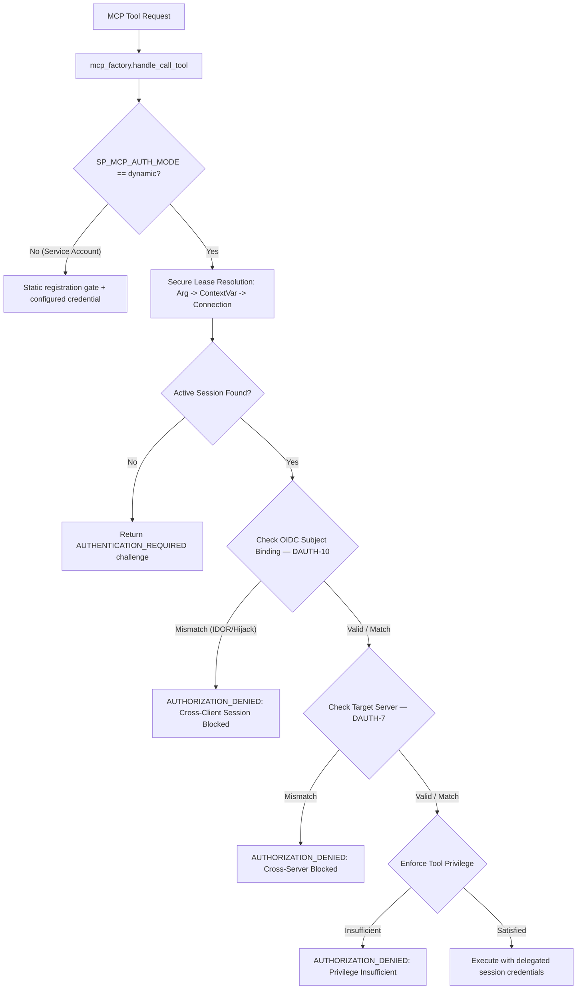

# Implementation: Dynamic & Delegated User Authentication

* **Domain**: Identity, Credentials & Delegated Authentication
* **Revision**: 2026-11 (Remediation Specification — DAUTH-10 Stdio Session Persistence & DAUTH-11 SSE Stream Principal Invariant Enforcement)
* **Status**: Specification updated — defines deterministic single-tenant stdio lease fallback (DAUTH-10), reverse-chronological lease resolution in SessionManager, and guarded SSE message intake (DAUTH-11)
* **Analysis reference**: [`docs/analysis/security-dynamic-authn-analysis.md`](../analysis/security-dynamic-authn-analysis.md)
* **Design reference**: [`docs/design/security-dynamic-authn.md`](../design/security-dynamic-authn.md)
* **Cross-reference**: [`docs/implement/impl-security-identity-credentials.md`](impl-security-identity-credentials.md) · [`docs/implement/impl-security-integrations.md`](impl-security-integrations.md) · [`docs/implement/impl-security-non-repudiation.md`](impl-security-non-repudiation.md) · [`docs/implement/impl-security-access.md`](impl-security-access.md) · [`docs/implement/impl-security-policy.md`](impl-security-policy.md)
* **Files targeted**: `src/sp_mcp_server/session.py`, `src/sp_mcp_server/commands/system/auth.py`, `src/sp_mcp_server/mcp_factory.py`, `src/sp_mcp_server/cli_wrapper.py`

---

## 1. Overview

This document details the implementation architecture, data structures, and code-level specifications for **Dynamic & Delegated User Authentication (Challenge-Response)**. It bridges the gap between interactive LLM chat clients (which cannot hold static credentials) and IBM Storage Protect server instances.

---

## 2. Component Architecture

The dynamic authentication subsystem consists of four core components:

1. **`SessionManager` (`src/sp_mcp_server/session.py`)**:
   Stores synchronized in-memory ephemeral session leases with bounded sliding inactivity expiration. Maps sessions to caller connection identifiers (`connection_id`) and OIDC identities (`oidc_subject`) for network transport isolation (`DAUTH-10`), using reverse-chronological search order to ensure re-authentication supersedes prior leases.
2. **`authenticate_session` Tool (`src/sp_mcp_server/commands/system/auth.py`)**:
   Verifies supplied credentials via zero-trace `execute_silent()`, captures caller OIDC metadata (`oidc_subject`) and transport connection IDs (`connection_id`), and provisions a bounded lease containing the username, password, and parsed privilege classes. Sets only request-scoped context variables (`current_session_id`, `current_audit_user`); module-level process globals are strictly prohibited.
3. **`logout_session` Tool (`src/sp_mcp_server/commands/system/auth.py`)**:
   Explicitly revokes an active session lease, zeros `SessionLease.password`, and clears active context variables. Enforces caller ownership checks so callers can only revoke their own session lease, preventing IDOR revocation attacks.
4. **Session Interceptor Hook (`src/sp_mcp_server/mcp_factory.py`)**:
   Enforces a strict, secure lease resolution order. Validates that the active caller's OIDC subject matches `session.oidc_subject` to prevent cross-client hijacking (`DAUTH-10`), verifies target server stanza alignment (`DAUTH-7`), and enforces tool privilege before delegated command execution.



---

## 3. Data Structures & Schemas

### 3.1 Ephemeral Session Lease Record

The `SessionLease` dataclass (in [`session.py`](../../src/sp_mcp_server/session.py)) includes `password` for delegated command execution, `target_server` for server binding, and `oidc_subject` / `connection_id` for multi-client transport isolation:

```python
from dataclasses import dataclass, field
from datetime import datetime, timezone
from typing import Optional, Set

@dataclass
class SessionLease:
    session_id: str
    username: str                          # IBM Storage Protect administrator username
    privilege_classes: Set[str]
    oidc_subject: Optional[str] = None     # OIDC 'sub' claim of the creator (DAUTH-10)
    connection_id: Optional[str] = None    # SSE connection / transport stream ID (DAUTH-10)
    transport_mode: str = "stdio"          # 'stdio' or 'http' (DAUTH-10)
    password: Optional[str] = None          # Retained for delegated execution; see AUD-02 / AUD-08
    created_at: datetime = field(default_factory=lambda: datetime.now(timezone.utc))
    last_accessed_at: datetime = field(default_factory=lambda: datetime.now(timezone.utc))
    ttl_seconds: int = DEFAULT_SESSION_TTL_SECONDS
    target_server: Optional[str] = None     # Enforced in mcp_factory._check_session_target_server() — DAUTH-7

    def is_expired(self) -> bool:
        """Check inactivity TTL and absolute MAX_SESSION_TTL_SECONDS."""
        now = datetime.now(timezone.utc)
        inactive_seconds = (now - self.last_accessed_at).total_seconds()
        total_seconds = (now - self.created_at).total_seconds()
        return inactive_seconds > self.ttl_seconds or total_seconds > MAX_SESSION_TTL_SECONDS

    def touch(self) -> None:
        self.last_accessed_at = datetime.now(timezone.utc)
```

> **AUD-08 (closed):** `password` is zeroed (`None`) on every removal path — `revoke_session()`, expiry in `get_session()`, `cleanup_expired()`, and `clear()`. The `logout_session` tool triggers `revoke_session()` for user-initiated revocation.

### 3.2 Standard Challenge Response Payload

When no session exists, the interceptor produces an error payload formatted in JSON:

```python
AUTHENTICATION_REQUIRED_PAYLOAD = {
    "is_error": True,
    "error_type": "AUTHENTICATION_REQUIRED",
    "message": "Authentication required. Please provide your IBM Storage Protect administrator credentials.",
    "challenge": {
        "required_fields": ["username", "password"],
        "supported_schemes": ["basic_delegated", "oidc_bearer"],
        "auth_tool": "authenticate_session"
    }
}
```

---

## 4. Code Specifications

### 4.1 Zero-Trace Authentication in `authenticate_session`

The authentication tool performs zero-trace validation against `dsmadmc`. `execute_silent()` returns `(stdout, stderr, return_code)`:

```python
# execute_silent return order: (stdout, stderr, return_code)
stdout, stderr, ret_code = self.cli.execute_silent(
    command="QUERY STATUS",
    admin_id=username,
    password=password,
)

if ret_code != 0:
    return json.dumps({
        "success": False,
        "error": "Authentication failed: invalid administrator credentials.",
        "returncode": ret_code,
        "details": (stderr or stdout or "Access denied").strip(),
    }, indent=2)

# Query admin authority level to establish privilege bounds
priv_out, _, _ = self.cli.execute_silent(
    command=f"QUERY ADMIN {username} FORMAT=DETAILED",
    admin_id=username,
    password=password,
)

privileges = _parse_privileges(priv_out)

# Mint session lease bound to OIDC subject and transport connection (DAUTH-10)
caller_sub = current_audit_user.get()  # Injected by OIDCBearerMiddleware
conn_id = current_connection_id.get()  # Injected by SSE transport handler
lease = global_session_manager.create_session(
    username=username,
    privileges=privileges,
    target_server=target_server,
    password=password,
    oidc_subject=caller_sub,
    connection_id=conn_id or "stdio",  # Bind "stdio" for single-tenant local process (DAUTH-10)
    transport_mode="http" if conn_id else "stdio",
)

# Set identity context for task-local audit & session tracking
# Strictly task-scoped: NO module-level process globals
current_audit_user.set(username)
current_session_id.set(lease.session_id)
```

> **AUD-09 (corrected):** The return order is `(stdout, stderr, return_code)` — corrected from the earlier `(return_code, stdout, stderr)` example in the original document.

### 4.2 Strict Resolution Hierarchy & Removal of Process Globals (DAUTH-10)

Module-level variables `_process_session_id` and `_process_audit_user` are completely eliminated. In `src/sp_mcp_server/mcp_factory.py`, the dynamic auth interceptor evaluates active session identity using a strict resolution order and enforces ownership checks to prevent cross-client hijacking:

```python
auth_mode = os.environ.get("SP_MCP_AUTH_MODE", "service_account").lower()
if auth_mode == "dynamic" and name != "authenticate_session":
    current_sub = current_audit_user.get()  # Injected by OIDC middleware
    conn_id = current_connection_id.get()   # Injected by SSE transport handler

    # 1. Resolve candidate session ID (Strict Order — DAUTH-10)
    candidate_sid = (
        (arguments and arguments.get("_session_id"))
        or current_session_id.get()
        or global_session_manager.get_session_id_for_connection(conn_id)
        or (
            global_session_manager.get_session_id_for_connection("stdio")
            if not conn_id and not current_sub
            else None
        )
    )

    if not candidate_sid:
        return [TextContent(type="text", text=json.dumps(challenge_payload, indent=2))]

    session = global_session_manager.get_session(candidate_sid)
    if session is None:
        return [TextContent(type="text", text=json.dumps(challenge_payload, indent=2))]

    # 2. Strict Principal & Connection Verification (Anti-Hijacking / Anti-IDOR)
    if session.oidc_subject and current_sub and session.oidc_subject != current_sub:
        logger.warning(
            "SECURITY: Cross-client session use attempt! OIDC subject '%s' "
            "attempted to use session belonging to '%s'.",
            current_sub, session.oidc_subject
        )
        return [TextContent(type="text", text=json.dumps({
            "is_error": True,
            "error_type": "AUTHORIZATION_DENIED",
            "message": "Session does not belong to the authenticated user.",
        }))]

    # 3. Target Server Verification (DAUTH-7)
    target_err = _check_session_target_server(session, config)
    if target_err:
        return [TextContent(type="text", text=json.dumps({
            "is_error": True,
            "error_type": "AUTHORIZATION_DENIED",
            "message": target_err,
        }))]

    # 4. Privilege Verification
    if not _privilege_satisfies_for_session(session, tool_privilege):
        return [TextContent(type="text", text=json.dumps({
            "is_error": True,
            "error_type": "AUTHORIZATION_DENIED",
            "message": "Authenticated session does not have the privilege required by this tool.",
        }))]
```

### 4.3 Secure Revocation in `logout_session`

In `src/sp_mcp_server/commands/system/auth.py`, `LogoutSession`:
1. Requires that the session being revoked matches the caller's connection ID or OIDC subject (`sub`), rejecting cross-user IDOR revocation attempts.
2. If no `session_id` argument is passed, revokes only the caller's active connection session.
3. Completely removes assignments resetting global state (`_factory._process_session_id = None`), ensuring another client's concurrent session is never disrupted.

### 4.4 Reverse-Chronological Session Lookup in `SessionManager` (DAUTH-10)

In `src/sp_mcp_server/session.py`, `get_session_id_for_connection()` traverses active sessions in reverse chronological order (`reversed(list(self._sessions.items()))`). When a user logs in under account B in a single-client stdio session that previously authenticated under account A, the newest active lease is returned, preventing FIFO dictionary lock-in.

### 4.5 SSE Stream Ownership Verification in `http_server.py` (DAUTH-11)

In `src/sp_mcp_server/http_server.py`, the ASGI application maintains a thread-safe registry `_sse_stream_owners: dict[str, str]` protected by `RLock`.
1. When `/mcp/sse` establishes an SSE connection, `record_stream_owner(conn_id, caller_sub)` registers the mapping.
2. The POST message route is wrapped in `guarded_post_messages`. The guard extracts `session_id` from the URL query string, queries the registry, and compares the registered owner's OIDC `sub` against `scope["state"]["mcp_subject"]`.
3. Caller mismatch immediately returns **HTTP 403 Forbidden** with JSON-RPC error `-32001`, blocking unauthenticated command execution across foreign streams.

---

## 5. Security & Operational Hardening

1. **Sliding Window Inactivity Timeout**:
   * Default timeout: **15 minutes** (`SP_MCP_SESSION_TTL=900`); absolute max **60 minutes** (`SP_MCP_SESSION_MAX_TTL=3600`).
   * Cleanup is opportunistic — triggered during `create_session()` and explicit `cleanup_expired()` calls; operators of long-lived processes should schedule periodic cleanup or rely on `SP_MCP_SESSION_MAX_TTL` to bound lease lifetimes.

2. **Credential Lifecycle (AUD-08)**:
   * `SessionLease.password` is set to `None` on every removal path: `revoke_session()`, expiry in `get_session()`, `cleanup_expired()`, and `clear()` at shutdown.
   * The `logout_session` tool calls `revoke_session()`, clears `current_session_id` / `current_audit_user`, and returns a JSON confirmation.

3. **Target-Server Binding (DAUTH-7)**:
   * `_check_session_target_server(session, config)` in `mcp_factory.py` returns an error string if `session.target_server` is set and does not match `config.server_address`.
   * Single-server deployments (no `target_server` on the lease) skip the check — fully backward-compatible.

4. **Identity Context Propagation (NR-1)**:
   * When `authenticate_session` succeeds, `current_audit_user` is set to the validated username.
   * Subsequent write executions propagate that username to the IBM Storage Protect Activity Log and execute through the active session credential context.

5. **Memory Safety & Zero-Trace**:
   * Plaintext passwords received in `authenticate_session` exist only within local stack frames and are zeroed from the session store on the first removal operation.
   * Credential verification commands are strictly routed through `execute_silent()`.

---

## 6. Testing & Validation Plan

| Test Case | Objective | Status |
|:---|:---|:---|
| `TestDynamicAuthentication::test_dynamic_auth_challenge_when_unauthenticated` | Tool calls without active session yield `AUTHENTICATION_REQUIRED` | ✅ |
| `TestDynamicAuthentication::test_authenticate_session_tool_valid_credentials` | Valid credentials create lease and set privilege context | ✅ |
| `TestDynamicAuthentication::test_authenticate_session_tool_invalid_credentials` | Invalid password returns structured failure response | ✅ |
| `TestDynamicAuthentication::test_session_ttl_is_bounded` | TTL capped at `MAX_SESSION_TTL_SECONDS` on create | ✅ |
| `TestDynamicAuthentication::test_dynamic_auth_denies_insufficient_privilege` | `{"any"}`-privilege session denied from `system`-privilege tool | ✅ |
| `TestDynamicAuthentication::test_dynamic_auth_executes_when_session_authenticated` | Tool executes; `current_audit_user` set from session username | ✅ |
| `TestDelegatedSubprocess::test_delegated_credentials_passed_to_subprocess` | `-ID=` and `-PA=` appear in `subprocess.run` call when `current_execution_credentials` set | ✅ |
| `TestDelegatedSubprocess::test_execution_credentials_cleared_after_tool_call` | `current_execution_credentials` is `None` after success and exception paths | ✅ |
| `TestOIDCAuthorization::test_oidc_scope_system_allows_system_tool` | `mcp:system` token allows `system`-privilege tool | ✅ |
| `TestOIDCAuthorization::test_oidc_scope_read_denies_write_tool` | `mcp:read` token denies `system`-privilege tool with `AUTHORIZATION_DENIED` | ✅ |
| `TestOIDCAuthorization::test_oidc_unknown_scope_treated_as_any` | Unknown scope resolves to `any` privilege | ✅ |
| `TestEntryPointStartup::test_all_main_entry_points_use_secure_startup` | All `main*.py` entry points call `secure_startup()` | ✅ |
| `TestSessionCredentialLifecycle::test_password_zeroed_on_revoke` | `SessionLease.password` is `None` after `revoke_session()` (AUD-08) | ✅ |
| `TestSessionCredentialLifecycle::test_password_zeroed_on_expiry_in_get_session` | `password` zeroed when expiry detected in `get_session()` (AUD-08) | ✅ |
| `TestSessionCredentialLifecycle::test_password_zeroed_on_cleanup_expired` | `password` zeroed in bulk `cleanup_expired()` sweep (AUD-08) | ✅ |
| `TestSessionCredentialLifecycle::test_password_zeroed_on_clear` | `password` zeroed on `clear()` / shutdown (AUD-08) | ✅ |
| `TestSessionCredentialLifecycle::test_logout_session_revokes_and_clears_credential` | `logout_session` revokes lease and confirms credential cleared (AUD-08) | ✅ |
| `TestSessionCredentialLifecycle::test_logout_session_no_active_session` | `logout_session` with no session returns graceful failure | ✅ |
| `TestSessionCredentialLifecycle::test_logout_session_explicit_session_id` | `logout_session` with explicit `session_id` parameter revokes correct lease | ✅ |
| `TestTargetServerBinding::test_cross_server_session_is_denied` | Mismatched `target_server` → `AUTHORIZATION_DENIED` with both server names (DAUTH-7) | ✅ |
| `TestTargetServerBinding::test_matching_target_server_is_allowed` | Matching `target_server` → command executes (DAUTH-7) | ✅ |
| `TestTargetServerBinding::test_no_target_server_on_session_is_allowed` | `target_server=None` → check skipped, command executes (DAUTH-7) | ✅ |
| `TestTargetServerBinding::test_check_session_target_server_helper_*` | Unit tests for `_check_session_target_server()` helper (3 paths) (DAUTH-7) | ✅ |
| `TestMultiClientDynamicAuthIsolation::test_cross_client_session_bleed_denied` | Client B cannot inherit Client A's session in shared process; cross-client usage rejected with `AUTHORIZATION_DENIED` (`DAUTH-10`) | ✅ |
| `TestMultiClientDynamicAuthIsolation::test_explicit_session_id_idor_rejected` | Supplying another caller's `_session_id` fails OIDC subject check with `AUTHORIZATION_DENIED` (`DAUTH-10`) | ✅ |
| `TestMultiClientDynamicAuthIsolation::test_logout_does_not_terminate_other_client_sessions` | Client B logging out revokes only their own session; does not affect Client A's active lease (`DAUTH-10`) | ✅ |
| `TestMultiClientDynamicAuthIsolation::test_dual_audit_attribution_logged` | Mutating tools in dynamic mode log compound attribution (`oidc_user=sub sp_admin=username`) (`POL-4` / `NR-1`) | ✅ |
| `TestMultiClientDynamicAuthIsolation::test_sse_endpoint_advertisement_correct` | SSE endpoint advertises `/mcp/messages` and accepts standard MCP HTTP clients | ✅ |
| `TestMultiClientDynamicAuthIsolation::test_stdio_dynamic_auth_multi_turn_sequence` | Sequential dispatch of `authenticate_session` and tool calls across discrete `asyncio.Task` instances succeeds via stdio fallback (`DAUTH-10`) | 📋 Spec Defined |
| `TestMultiClientDynamicAuthIsolation::test_stdio_reauthentication_supersedes_prior_lease` | Sequential authentication under new admin account supersedes prior lease via reverse search (`DAUTH-10`) | 📋 Spec Defined |
| `TestMultiClientDynamicAuthIsolation::test_sse_cross_user_post_rejected_with_403` | Foreign caller POST to active stream UUID rejected with HTTP 403 Forbidden (`DAUTH-11`) | 📋 Spec Defined |
| `TestMultiClientDynamicAuthIsolation::test_sse_legitimate_post_accepted_with_202` | Stream owner POST to matching stream UUID accepted with HTTP 202 (`DAUTH-11`) | 📋 Spec Defined |
| `TestMultiClientDynamicAuthIsolation::test_cross_transport_stdio_leak_blocked` | Unauthenticated network HTTP request never inherits local `"stdio"` lease (`DAUTH-10`) | 📋 Spec Defined |

---

## 7. Cross-References

* Design Spec: [`docs/design/security-dynamic-authn.md`](../design/security-dynamic-authn.md)
* Analysis: [`docs/analysis/security-dynamic-authn-analysis.md`](../analysis/security-dynamic-authn-analysis.md)
* Identity & Credentials Implementation: [`docs/implement/impl-security-identity-credentials.md`](impl-security-identity-credentials.md)
* Integrations Implementation: [`docs/implement/impl-security-integrations.md`](impl-security-integrations.md)
* Non-Repudiation Implementation: [`docs/implement/impl-security-non-repudiation.md`](impl-security-non-repudiation.md)
* Access Management Implementation: [`docs/implement/impl-security-access.md`](impl-security-access.md)
* Policy Management Implementation: [`docs/implement/impl-security-policy.md`](impl-security-policy.md)
* Traceability Matrix: [`docs/traceability/traceability-matrix.md`](../traceability/traceability-matrix.md)
