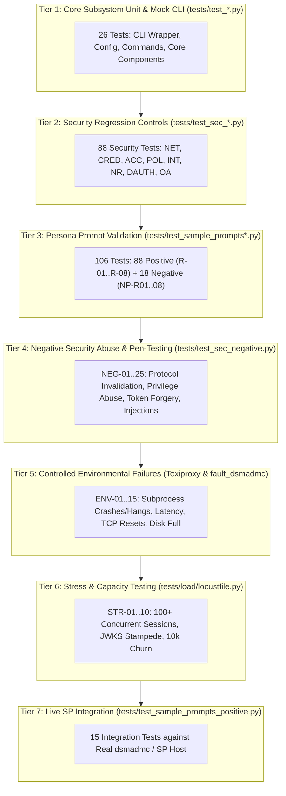

# Test Documentation

Comprehensive test engineering documentation for the IBM Storage Protect Model Context Protocol (MCP) Server.

This directory contains the formal test specifications, test case catalog, and execution procedures covering the full testing lifecycle across unit testing, security control verification, mock CLI harness execution, persona prompt scenarios, micro-MCP process isolation, and live IBM Storage Protect integration.

---

## Document Map

| Document | Purpose & Scope |
| :--- | :--- |
| [`test-specifications.md`](test-specifications.md) | **Test Strategy & Engineering Specification**: Testing scope, objectives, 8 test levels (including negative abuse and environmental resilience), execution environments, test isolation guarantees, quality gates (QG-1 through QG-9), and traceability matrices. |
| [`test-cases.md`](test-cases.md) | **Comprehensive Test Case Catalog**: Detailed specifications for all 188 automated test cases, 25 negative test cases (NEG-01..25), 15 controlled environmental failure cases (ENV-01..15), and 10 stress & capacity test cases (STR-01..10). |
| [`test-procedures.md`](test-procedures.md) | **Test Execution Procedures & Runbooks**: Step-by-step procedures PROC-01 through PROC-11 covering automated suites, domain verification, fault injection runbooks, Locust load generation, and adversarial security penetration testing. |
| [`test-bed.md`](test-bed.md) | **Test-Bed Architecture & Engineering Blueprint**: Multi-container Docker Compose topology, stateful mock SP daemon, dynamic CLI fault injection shim (`fault_dsmadmc.py`), Toxiproxy network chaos proxy, and Locust load injection harness. |

---

## Test Architecture & Taxonomy Overview

The testing strategy is built upon a multi-tier testing pyramid designed to validate security invariants, fault resilience, and operational capabilities without requiring a live mainframe or dedicated enterprise storage cluster for daily continuous integration:



### Key Metrics
* **Total Collected Unit/Mock Tests**: **266 items** across 15 test files
* **Automated Passing Tests**: **248 passing tests** (100% pass rate in default suite order)
* **Live Integration Stubs**: **15 skipped tests** (activated when live SP credentials/server configured)
* **Platform Conditional Tests**: **3 skipped tests** on Windows (POSIX file permission bit tests)
* **Persona Prompt Tests**: **121 automated tests** (103 positive in `tests/test_sample_prompts_positive.py` + 18 negative in `tests/test_sample_prompts_negative.py`) covering all 8 personas (`R-01` through `R-08`)
* **Negative Test Scenarios**: **43 negative test specifications** (25 security abuse NEG-01..25 + 18 adversarial persona prompts NP-R01..08)
* **Controlled Failure Scenarios**: **15 environmental failure specifications** (ENV-01 through ENV-15)
* **Stress & Capacity Scenarios**: **10 stress/load specifications** (STR-01 through STR-10)
* **Security Controls Covered**: **51 formal security requirements** across 8 domains
* **Quality Gates Enforced**: **9 formal gates** (QG-1 through QG-9)

---

## Quick Start: Running Tests

### 1. Prerequisites
Ensure the virtual environment is activated and dependencies are installed:
```bash
# Activate virtual environment
source .venv/bin/activate    # Linux / macOS
.\.venv\Scripts\Activate.ps1 # Windows PowerShell

# Verify dependencies
pip check
```

### 2. Run the Full Test Suite
```bash
pytest -v
```

### 3. Run Specific Test Suites
```bash
# Run security controls only
pytest tests/test_sec_*.py -v

# Run persona prompt validation tests
pytest tests/test_sample_prompts_positive.py -v

# Run OAuth 2 extended middleware suite
pytest tests/test_sec_oauth2.py -v
```

---

## Cross-References

- System Architecture: [`../architecture/architecture.md`](../architecture/architecture.md)
- Security Architecture Analysis: [`../analysis/security-design-analysis.md`](../analysis/security-design-analysis.md)
- Security Design Specs: [`../design/`](../design/)
- Implementation Specs: [`../implement/`](../implement/)
- Traceability Matrix: [`../traceability/traceability-matrix.md`](../traceability/traceability-matrix.md)
- Audit & Verification Report: [`../traceability/audit-report.md`](../traceability/audit-report.md)

