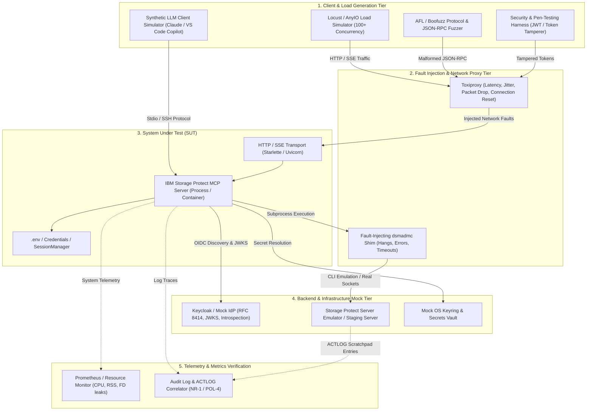
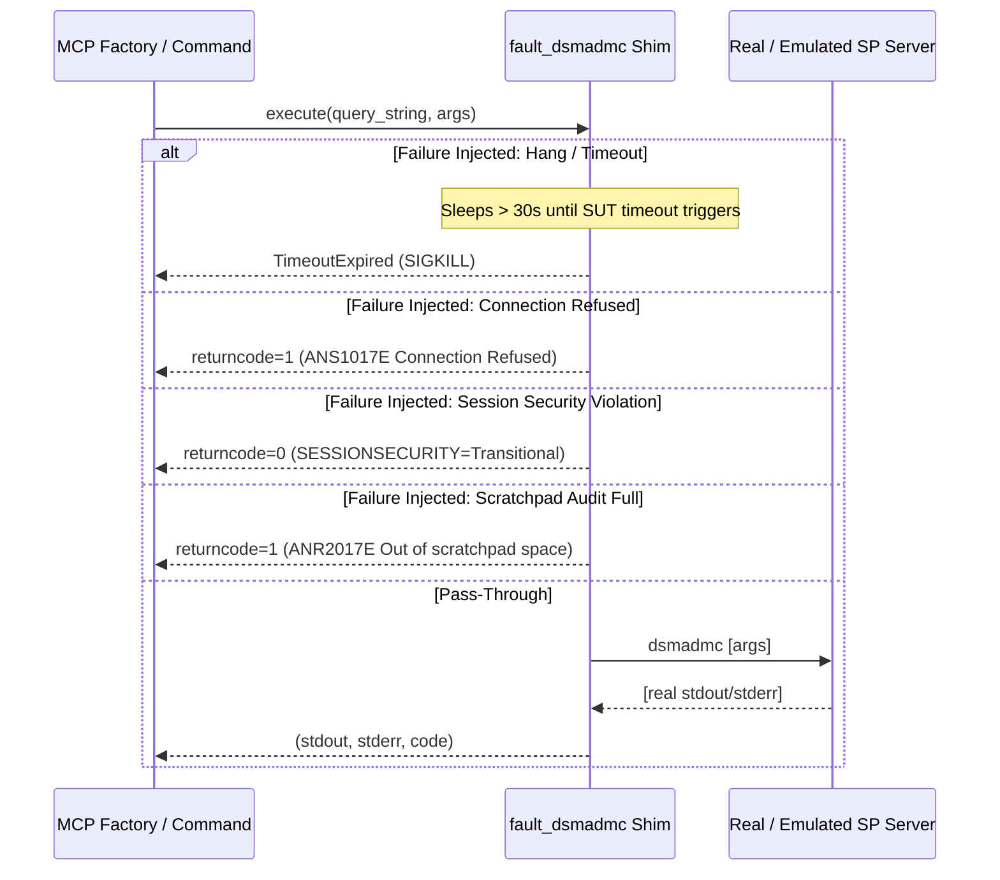
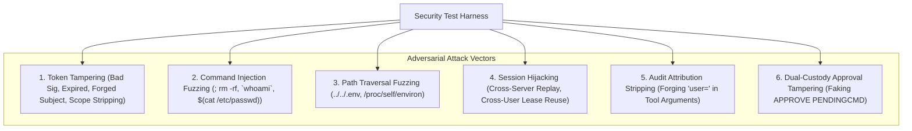

# Test-Bed Engineering Architecture & Specification

* **Document**: Automated Resilience, Fault Injection, Load Simulation & Security Test-Bed
* **Revision**: 2026-10
* **Status**: Architectural Specification & Implementation Blueprint
* **Cross-References**: [`test-specifications.md`](test-specifications.md) · [`test-cases.md`](test-cases.md) · [`test-procedures.md`](test-procedures.md) · [`../architecture/architecture.md`](../architecture/architecture.md)

---

## 1. Test-Bed Overview & Architectural Topology

The **IBM Storage Protect MCP Server Test-Bed** is a containerized, deterministic testing harness designed to subject the server to controlled environmental failures, network disruptions, heavy concurrent load, protocol edge cases, and adversarial security attacks.



---

## 2. Test-Bed Core Subsystems

### 2.1 Fault-Injecting Subprocess Shim (`fault_dsmadmc.py`)
In standard operation, `DsmAdmcWrapper` executes the native `dsmadmc` executable. The test-bed provides an intercepting wrapper configured via `SP_FAULT_INJECTOR_CONFIG` that simulates all known SP failure conditions without modifying server source code:



#### Fault Profiles Supported:
* `ANS1017E`: Server down / network unreachable.
* `ANS1025E`: Invalid password / lockout exceeded (`INVALIDPWLIMIT`).
* `ANS1353E`: Session security mismatch (`SESSIONSECURITY=Transitional`).
* `ANS0220E`: Database full / recovery log exhaustion.
* `HANG_PROC`: Subprocess deadlocks or infinite loops to test async thread pool resilience and timeout cancellation.
* `SIGPIPE`: Early stdout pipe closure simulation.
* `CORRUPT_JSON`: Truncated or malformed output formatting.

### 2.2 Network Chaos & Fault Injection Proxy (Toxiproxy)
For HTTP/SSE transport validation (`--transport http`), network conditions between clients, the MCP server, and IdP discovery endpoints are modulated using a local Toxiproxy container:

| Fault Injected | Toxic Type | Parameters | Evaluated Resilience Invariant |
| :--- | :--- | :--- | :--- |
| **IdP Latency Spike** | `latency` | 5000 ms, 500 ms jitter | JWKS cache lookup must not block concurrent tool calls. |
| **IdP TCP Reset** | `reset_peer` | Immediate on connection | Token verification fails open or closed according to security policy. |
| **Bandwidth Choke** | `bandwidth` | 10 KB/s rate limit | SSE client streaming endurance under slow-consumer conditions. |
| **Packet Drop / Loss** | `slicer` | 20% drop rate | HTTP keep-alive, connection reconnection resilience. |
| **Discovery Outage** | `down` | Endpoint disabled | Startup fail-open capability check (OA-4). |

### 2.3 Load & Concurrency Simulator (Locust / AnyIO)
Validates system throughput, connection limits, and memory endurance under sustained high-concurrency workloads:
- **Concurrency Targets**: 1 to 200 concurrent simulated LLM clients.
- **Workload Mix**:
  - 70% Read queries (`query_status`, `query_session`, `query_storage_pool`, `query_node`).
  - 15% Authentication leases (`authenticate_session`, `logout_session`).
  - 10% Write operations requiring dual-custody approval or audit attribution (`delete_admin`, `update_node`).
  - 5% OAuth 2 discovery & metadata polling (`/.well-known/oauth-authorization-server`, `/.well-known/oauth-protected-resource`).

### 2.4 User Security & Adversarial Pen-Testing Engine
Automates attack vectors targeting the MCP protocol, authentication leases, and command execution boundaries:



---

## 3. Test-Bed Deployment & Orchestration

### 3.1 Docker Compose Test-Bed Topology
The complete test-bed is declared in an automated multi-service topology:

```yaml
version: '3.8'

services:
  # 1. System Under Test
  sp-mcp-server:
    build:
      context: .
      dockerfile: Dockerfile.test
    environment:
      - TCPSERVERADDRESS=mock-sp-server
      - SP_SERVER_PORT=1500
      - SP_ADMIN_ID_SYSTEM=mcp-svc-system
      - SP_ADMIN_PASSWORD_SYSTEM=SecretPassword123!
      - SP_MCP_ENV=test
      - SP_OIDC_ISSUER=http://toxiproxy:8444/realms/mcp-test
      - SP_OIDC_AUDIENCE=sp-mcp-server
      - SP_TLS_CERT=/certs/server.crt
      - SP_TLS_KEY=/certs/server.key
      - SP_MCP_PUBLIC_URL=https://localhost:8443
    ports:
      - "8443:8443"
    depends_on:
      - mock-idp
      - toxiproxy
      - mock-sp-server

  # 2. Network Fault Injection Proxy
  toxiproxy:
    image: ghcr.io/shopify/toxiproxy:2.9.0
    ports:
      - "8474:8474" # Management API
      - "8444:8444" # Proxied IdP port
      - "1501:1501" # Proxied SP port

  # 3. Mock Identity Provider (Keycloak / Mock IdP)
  mock-idp:
    image: quay.io/keycloak/keycloak:24.0.0
    command: start-dev --http-port=8080
    environment:
      - KEYCLOAK_ADMIN=admin
      - KEYCLOAK_ADMIN_PASSWORD=admin
    ports:
      - "8080:8080"

  # 4. Mock Storage Protect Server Emulator
  mock-sp-server:
    build:
      context: ./tests/mock_sp
    ports:
      - "1500:1500"

  # 5. Load Generator
  load-generator:
    image: locustio/locust:2.24.0
    volumes:
      - ./tests/load:/mnt/locust
    command: -f /mnt/locust/locustfile.py --host https://sp-mcp-server:8443
    depends_on:
      - sp-mcp-server
```

---

## 4. Test-Bed Verification Scenarios

### Scenario A: High-Throughput Token Stampede (Cache Stampede Test)
* **Setup**: 100 concurrent requests present tokens with 50 distinct random `kid` values.
* **Fault Injected**: IdP JWKS endpoint restricted to 10 requests per minute via Toxiproxy.
* **Success Criteria**:
  1. `http_server.py` rate-limiting absorbs the stampede, allowing only 1 outbound JWKS refresh per 60 seconds (OA-2).
  2. Server returns `401 Unauthorized` for invalid `kid` without exhausting outbound TCP sockets or crashing.
  3. Memory consumption remains stable (< 200 MB RSS).

### Scenario B: Storage Protect Activity Log Disk Full (Audit Fail-Closed)
* **Setup**: Server configured with `SP_MCP_STRICT_AUDIT=1`.
* **Fault Injected**: `fault_dsmadmc` returns error code 1 (`ANR9999E Disk full writing ACTLOG`) for `DEFINE SCRATCHPADENTRY`.
* **Success Criteria**:
  1. Every write tool (`delete_admin`, `update_node`, `define_schedule`) is immediately blocked.
  2. Target commands are never submitted to the backend SP engine.
  3. Server logs `SECURITY [POL-4 / RG-4 / NR-4]` at `ERROR` level with the correlation ID.
  4. Non-write operations (`query_status`, `query_occupancy`) continue to function without interruption.

### Scenario C: Process Memory Leak & Session Saturation Test
* **Setup**: Load generator creates and revokes 10,000 ephemeral sessions over 30 minutes.
* **Fault Injected**: 30% of sessions abandoned without explicit logout (forcing TTL expiration).
* **Success Criteria**:
  1. `SessionManager` background cleanup sweeps remove expired leases strictly within `SP_MCP_SESSION_MAX_TTL`.
  2. Passwords are confirmed overwritten (`0x00`) in memory for all 10,000 leases.
  3. Python memory profile (RSS) demonstrates zero unbounded growth (delta < 15 MB).
  4. ContextVars remain strictly scoped to individual async request coroutines.
