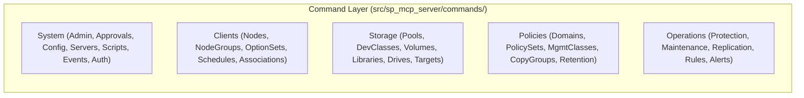
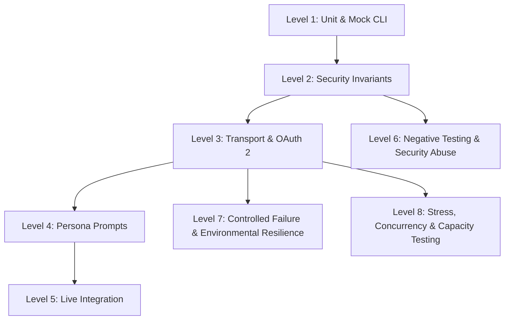

# Test Engineering Specification

* **Document**: Test Specifications for IBM Storage Protect MCP Server
* **Revision**: 2026-10 (Post-Remediation Alignment & Full Suite Coverage)
* **Status**: Approved & Verified
* **Inputs & Reference Base**:
  * Architecture Documents: [`docs/architecture/architecture.md`](../architecture/architecture.md), [`module-*.md`](../architecture/)
  * High-Level Security Design Documents: [`docs/design/security-*.md`](../design/)
  * Low-Level Implementation Specifications: [`docs/implement/impl-security-*.md`](../implement/)
  * User & Deployment Guides: [`docs/guides/`](../guides/)
  * Source Code: [`src/sp_mcp_server/`](../../src/sp_mcp_server/)
  * Test Automation Suite: [`tests/`](../../tests/) (188 collected tests across 12 files)
  * Traceability Matrix: [`docs/traceability/traceability-matrix.md`](../traceability/traceability-matrix.md)

---

## 1. Introduction & Objectives

### 1.1 Purpose
This specification establishes the engineering principles, architectural scope, test levels, environmental requirements, and quality verification criteria for validating the **IBM Storage Protect Model Context Protocol (MCP) Server**. 

The MCP server acts as an AI-to-infrastructure bridge, exposing IBM Storage Protect administrative capabilities to LLM clients (such as Claude Desktop, VS Code Copilot, or custom REST/SSE gateways) while enforcing strict enterprise security controls, privilege gating, forensic non-repudiation, and cross-platform reliability.

### 1.2 Primary Test Objectives
1. **Security Control Invariant Verification**: Guarantee that every security requirement across all eight domains (NET, CRED, ACC, POL, INT, NR, DAUTH, OA) strictly fails closed and cannot be bypassed.
2. **Execution Integrity & Silent Handling**: Ensure credentials (passwords, session keys, tokens) never leak into subprocess command lines, application logs, or MCP response payloads.
3. **Micro-MCP Process Scoping**: Verify that individual micro-MCP entry points register only the least-privilege tool subsets assigned to their domain stanzas.
4. **Transport & Protocol Fidelity**: Verify compliance with MCP specification (JSON-RPC 2.0, SSE), RFC 8414 (AS Metadata), RFC 7517 (JWKS), RFC 7636 (PKCE), RFC 7662 (Token Introspection), and RFC 9470 (OAuth Protected Resource Metadata).
5. **State Isolation & Repeatability**: Ensure tests execute independently and deterministically under any collection order or parallel runner.

---

## 2. Testing Scope

### 2.1 Functional Command Surface
The test specifications cover the complete command abstraction layer comprising **231 concrete command classes** organized across five business modules:



### 2.2 Entry Point Architecture
Testing encompasses all **26 entry point scripts**:
- **Unified Entry Point (`main.py`)**: Validates CLI parsing (`--enable-servers`, `--mode`, `--transport`, `--port`, `--host`), IdP capability checks, and composite server creation.
- **25 Micro-MCP Entry Points (`main_*.py`)**: Validates standalone process execution with hardcoded least-privilege server group registration.

### 2.3 Security Controls Scope
Comprehensive validation of all **51 formal security requirements**:
- **NET-1 – NET-3**: Session security (`SESSIONSECURITY=STRICT`), TLS 1.2/1.3, SSH key authentication.
- **CRED-1 – CRED-5**: 5-tier service account hierarchy, password stash, POSIX 0600 `.env` checks, non-interactive MFA policies, and automated provisioning.
- **ACC-1 – ACC-4**: Per-tool authority checks, self-narrowing tool registry, non-root `sudo -u` execution.
- **POL-1 – POL-4**: Dual-custody command approval (`APPROVE PENDINGCMD`), `MINPWLENGTH` pre-validation, lockout policy verification (`INVALIDPWLIMIT`), and ACTLOG scratchpad audit attribution.
- **INT-1 – INT-4**: OIDC bearer token privilege mapping, HTTP transport TLS certificate enforcement (`RG-5`), keyring secret resolution.
- **NR-1 – NR-5**: End-user identity binding in ACTLOG, fail-closed audit mode (`SP_MCP_STRICT_AUDIT=1`), ISO 8601 UTC timestamps.
- **DAUTH-1 – DAUTH-11**: Challenge-response dynamic auth, ephemeral bounded lease TTL, zero-trace subprocess arguments, credential zeroing on deletion, target server binding (`_check_session_target_server`).
- **OA-1 – OA-7**: RFC 8414 AS metadata proxying, JWKS TTL rotation and kid-miss throttling, PKCE capability validation, RFC 7662 token introspection, RFC 9470 protected resource metadata, and cross-model `authmodel` audit attribution.

---

## 3. Test Levels & Methodology



### Level 1: Subprocess & CLI Mock Testing
- **Target**: `DsmAdmcWrapper`, `DsmServWrapper`, `ServermonWrapper`, `BaseCommand`, `BaseOfflineCommand`.
- **Methodology**: Mocking subprocess execution (`subprocess.Popen` / `subprocess.run`) using `mock_admc` fixtures to verify command line construction, quoting, exit code handling, and silent execution for password-bearing operations (`_execute_silent_query`).

### Level 2: Security Invariants Verification
- **Target**: `mcp_factory.py`, `config.py`, `session.py`.
- **Methodology**: Invariant assertion testing. Simulating non-compliant environments (e.g. non-strict session security, missing `.env` permissions, invalid lockout policies, bypass flags in production) and verifying immediate fail-closed termination (`sys.exit(1)` or `RuntimeError`).

### Level 3: Transport & OAuth 2 Protocol Testing
- **Target**: `http_server.py`, `OIDCBearerMiddleware`.
- **Methodology**: ASGI test harness execution with `respx` mocking external HTTP interactions (IdP OpenID configuration discovery, JWKS endpoints, token introspection). Evaluates JWT token claims, scope-to-privilege mapping, cache expiry, kid-miss rate limiting, and HTTP response headers (`WWW-Authenticate`).

### Level 4: Persona Prompt & AI Workflow Validation
- **Target**: Complete tool catalogs across all eight operational personas defined in [`docs/example/sample-prompts.md`](../example/sample-prompts.md):
  - **R-01 (Data Protection Operator)**: Daily status checks, client session queries, node occupancy, backup schedule associations, drive/path status, and failure triage (`TestR01DiscoveryAndStatus`, `TestR01BackupPolicyAndScheduling`, `TestR01NodeLifecycle`, `TestR01StoragePoolConfiguration`).
  - **R-02 (Data Protection Administrator)**: Performance tuning (`TXNGROUPMAX`, `MOVEBATCHSIZE`), recovery log diagnostics (`QUERY LOG`), 7-day schedule miss history (`QUERY EVENT`), storage reclamation tuning (`TestR02PerformanceTuning`, `TestR02DatabaseDiagnostics`, `TestR02OperationalAudit`).
  - **R-03 (Infrastructure Solution Architect)**: Container deduplication statistics, cloud/tape device class inspection, container storage pool directory expansion, and enterprise license compliance auditing (`TestR03EnvironmentAndSizing`).
  - **R-04 (Workload & Application Owner)**: Database backup volume file spaces, SAP redo-log archiving copy group definitions, and Oracle database occupancy analysis (`TestR04WorkloadBackupIntegration`).
  - **R-05 (Security & Compliance Officer)**: `SESSIONSECURITY=STRICT` compliance audit, dual-custody approval workflows, password lockout policies, ACTLOG scratchpad forensic extraction, and policy domain retention rules (`TestR05SecurityHardening`, `TestR05PolicyAudit`).
  - **R-06 (Resilience Operations Manager)**: Suspected ransomware node isolation (`SetClientLock`), server database disaster recovery restore (`RestoreDB`), DR plan file status queries (`QueryRecoveryPlanFile`), and offsite media tracking (`TestR06ResilienceOperations`).
  - **R-07 (Storage Protect Service Engineer)**: Servermon diagnostic utility invocation (`RunServerMon`), activity log defect triage for specific message codes (`ANR0406E`), and cloud migration warning frequency analysis (`ANR8468W`) (`TestR07ServiceEngineerDiagnostics`).
  - **R-08 (Multi-Server Replication & Data Management)**: Multi-server replication topology discovery, cross-server storage rules, replication failure record retrieval, per-node replication progress monitoring, storage pool synchronization verification, failover node reconfiguration, and storage tiering rule queries (`TestR08MultiServerReplication`).
  - **Tool Privilege Tier Annotations**: Runtime validation of read-only tool flags and required privilege tiers (`policy`, `operator`, `storage`, `system`) (`TestPromptToolPrivilegeAnnotations`).
- **Methodology**: Automated verification in `tests/test_sample_prompts_positive.py` (103 tests: 88 unit + 15 live integration) and `tests/test_sample_prompts_negative.py` (18 tests), validating prompt-to-tool argument translation, exact SP command construction, and schema validation.

### Level 5: Live IBM Storage Protect Integration Testing
- **Target**: End-to-end integration with live IBM Storage Protect instance.
- **Methodology**: Conditional execution against real `dsmadmc` client connected to a live staging server. Verifies actual SP response parsing, live scratchpad ACTLOG writes, and real command approvals.

### Level 6: Negative Testing & Security Abuse Strategy
- **Target**: All MCP tool endpoints, parameter sanitization engines, authentication barriers, and authorization enforcement filters.
- **Methodology**: Systematic injection of malformed inputs, boundary violations, privilege escalation exploits, token forgery, and prompt injection attacks. Validates that the server rejects invalid requests fail-closed without stack trace leakage, memory corruption, or unauthenticated command execution:
  - **Protocol & Schema Invalidation**: Malformed JSON-RPC frames, unexpected data types, missing required parameters, oversized payload fuzzing (10MB+ strings), array-type injection where scalars expected.
  - **Privilege Boundary Breaches**: Low-privilege accounts (e.g., `operator`) attempting Restricted/System-tier commands (`HALT`, `UPDATE ADMIN`, `DEF DOMAIN`), and bypassing server group scoping.
  - **Dual-Custody Bypass Attacks**: Attempts to approve self-initiated commands, re-executing already consumed pending approvals, forging approval IDs, and invoking destructive commands without dual-custody approval.
  - **Authentication Tampering**: Expired JWT tokens, untrusted issuer signatures, mismatched audience claims, stripped OAuth scopes, replay of tokens across target servers, and cross-session privilege pollution.
  - **Command Injection & Escaping**: Shell metacharacters (`;`, `&&`, `|`, `` ` ``, `$()`, `\n`) embedded inside node names, volume paths, domain names, and password parameters.

### Level 7: Controlled Failure & Environmental Resilience Testing Strategy
- **Target**: Subprocess execution layers, network transport connections, IdP endpoints, filesystem storage, and process crash recovery.
- **Methodology**: Deterministic fault injection using simulated network degradation and CLI shim interceptors as specified in [`test-bed.md`](test-bed.md):
  - **Subprocess Failures & Exit Traps**: Injecting `dsmadmc` non-zero return codes (`ANS1017E` Session rejected, `ANS1025E` Authentication failure, `ANS1353E` Session security mismatch, `ANR2017E` Administrator not authorized), simulated process crashes (SIGKILL, exit 137), and zombie subprocess handling.
  - **Subprocess Deadlocks & Hangs**: Simulating hung `dsmadmc` instances waiting indefinitely on stdin or network sockets, validating strict command timeout enforcement and clean PID process termination.
  - **Network Disruptions (Toxiproxy)**: Injecting latency spikes (5000ms), TCP packet resets, asymmetric network partitioning, and connection drops during SSE event stream transmission.
  - **Identity Provider (IdP) Outages**: Simulating IdP HTTP 500/503 errors during JWKS retrieval, network timeouts during token introspection, and discovery document corruption. Validates caching resilience and fail-closed security.
  - **Storage & Filesystem Failures**: Simulating disk-full conditions on ACTLOG scratchpad logging directories (`ENOSPC`), read-only `.env` file permission corruptions, and temporary directory access denials. Validates fail-closed audit requirements (`SP_MCP_STRICT_AUDIT=1`).

### Level 8: Stress, Concurrency & Capacity Testing Strategy
- **Target**: ASGI HTTP/SSE transport, `SessionManager` ephemeral storage, connection pools, and thread concurrency boundaries.
- **Methodology**: Multi-threaded load generation using Locust and AnyIO test harnesses executing concurrent tool invocations:
  - **Concurrent Session Scaling**: Sustained load of 100 to 200 concurrent simulated AI agent sessions issuing concurrent `QUERY` and `SELECT` commands.
  - **Session Cache Saturation**: Rapid generation and eviction of 10,000 ephemeral authenticated sessions to verify garbage collection, bounded memory footprint, and absence of memory leaks.
  - **JWKS Cache Stampede & Throttling**: Injecting bursts of 500 requests with unassigned Key IDs (`kid`) to verify that the rate limiter throttles outbound IdP requests and prevents upstream denial-of-service.
  - **SSE Streaming Endurance**: Long-duration SSE connections streaming ACTLOG log events under slow-consumer network conditions to verify backpressure handling and socket buffer exhaustion resistance.

---

## 4. Test Environment & Execution Architecture

### 4.1 Mock Subprocess & Fast-Crypto Fixtures
Unit tests run completely isolated from external infrastructure:
- **`tests/fixtures.py`**: Provides standardized IBM Storage Protect CLI output stubs (e.g., `QUERY STATUS`, `QUERY ADMIN`, `QUERY SESSION`, `QUERY OCCUPANCY`), fake RSA/EC keypairs for JWT minting, and pre-built `ServerConfig` instances.
- **`respx` Integration**: Intercepts outbound HTTP requests to fake IdP endpoints (`https://login.microsoftonline.com/`, `https://idp.corp.example.com/`) with sub-millisecond in-memory responses.

### 4.2 Test State Isolation Architecture
To prevent cross-test state pollution (as identified in historical audit finding AUD-F-01), the test suite enforces strict execution hygiene via [`tests/conftest.py`](../../tests/conftest.py):

```python
@pytest.fixture(autouse=True)
def clean_test_execution_state():
    """Autouse fixture ensuring ContextVars, globals, and session caches are clean."""
    reset_execution_state()
    yield
    reset_execution_state()
```

`reset_execution_state()` resets:
1. `current_audit_user` ContextVar (`None`)
2. `current_execution_credentials` ContextVar (`None`)
3. `current_auth_model` ContextVar (`None`)
4. `current_session_id` ContextVar (`None`)
5. `current_request_privilege` ContextVar (`None`)
6. Module globals (`_process_session_id = None`, `_process_audit_user = None`)
7. `SessionManager` cache (`_session_manager.clear()`)

### 4.3 Platform Conditional Execution (Windows vs POSIX)
- The server codebase is OS-independent, but POSIX permission bits (`0o600`) cannot be validated on Windows NTFS (`os.chmod()` retains `0o666`).
- `config.py` contains a Windows guard (`if os.name == 'nt': return`).
- Tests that explicitly assert `SystemExit` upon setting mode `0o644` or `0o640` are decorated with:
  ```python
  @pytest.mark.skipif(sys.platform == "win32", reason="POSIX file permission bits not supported on Windows")
  ```

### 4.4 Containerized Test-Bed Architecture Integration
For Level 6 (Negative Testing), Level 7 (Environmental Resilience), and Level 8 (Stress/Capacity Testing), tests run against the integrated Dockerized Test-Bed defined in [`docs/test/test-bed.md`](test-bed.md):
- **Mock SP Daemon (`sp-server-mock`)**: Emulates `dsmserv` admin port 1500 with TLS 1.3 and stateful ACTLOG.
- **Fault Injection CLI Shim (`fault_dsmadmc.py`)**: Intercepts `dsmadmc` process invocations via `PATH` pre-emption, reading dynamic error configurations from `/tmp/sp_fault_injection.json` to inject delays, process hangs, and specific return codes.
- **Toxiproxy Chaos Proxy (`toxiproxy:8474`)**: Manages TCP proxies between client, MCP server, and simulated IdP/SP backends, injecting latency, connection resets, and bandwidth throttling.
- **Load Generation Engine (`locust:8089`)**: Drives high-concurrency AnyIO/Locust worker swarms to evaluate p95/p99 response latencies, connection pool starvation, and memory leaks.

---

## 5. Pass/Fail Quality Gates

A test run is considered **Passed** if and only if all of the following gates are satisfied:

| Gate ID | Quality Gate | Requirement | Verification Method |
| :--- | :--- | :--- | :--- |
| **QG-1** | **Unit Test Pass Rate** | 100% of runnable unit/mock tests pass (170/170). 0 failures, 0 errors. | Automated `pytest` run |
| **QG-2** | **Test Isolation** | Suite must pass with identical results under randomized execution order. | `pytest-randomly` / `conftest.py` autouse |
| **QG-3** | **No Credential Leaks** | Plaintext passwords must never appear in `execute()` command strings or standard logs. | `caplog` inspection in silent execution tests |
| **QG-4** | **Fail-Closed Security** | Security violations must terminate with `sys.exit(1)` or `AUTHORIZATION_DENIED`. | Explicit exception and return assertions |
| **QG-5** | **Zero Broken Links** | Documentation must contain 0 broken file targets and 0 malformed URL fragments. | Automated AST link scanner |
| **QG-6** | **Package Dependency Integrity** | `pip check` must report zero dependency conflicts between runtime and extras. | `python -m pip check` |
| **QG-7** | **Negative Test Security Isolation** | 100% of negative security test cases must fail closed with sanitized error envelopes; zero stack trace leakage or command execution. | Automated Negative Test Suite |
| **QG-8** | **Environmental Fault Recovery** | Server must recover automatically from transient network resets and IdP timeouts without process death; non-zero `dsmadmc` exit codes must map cleanly to MCP errors. | Test-Bed Chaos & Fault Injection Suite |
| **QG-9** | **Stress Concurrency & Resource Bound** | Under 100 concurrent simulated agent sessions, server memory RSS must remain bounded (<= 256MB), zero open socket leaks, and p95 latency <= 500ms (excluding backend SP time). | Locust Load Benchmark & Memory Profiler |

---

## 6. Requirements Traceability Matrix

| Requirement Domain | Key Requirement IDs | Implementing Source Files | Test Automation File(s) | Primary Test Classes |
| :--- | :--- | :--- | :--- | :--- |
| **Network Security** | NET-1, NET-2, NET-3, RG-1 | `mcp_factory.py`, `main.py` | `tests/test_sec_startup.py` | `TestValidateSessionSecurity`, `TestProductionGuard` |
| **Identity & Credentials** | CRED-1, CRED-2, CRED-3, RG-2, RG-3 | `config.py`, `cli_wrapper.py`, `commands/base.py` | `tests/test_sec_startup.py`, `tests/test_sec_password_commands.py`, `tests/test_config.py` | `TestEnvFilePermissions`, `TestSecureStartup`, `TestPasswordCommandsSilentExecution` |
| **Access Management** | ACC-1, ACC-2, ACC-3, ACC-4 | `mcp_factory.py`, `cli_wrapper.py` | `tests/test_sec_startup.py`, `tests/test_cli_wrapper.py` | `TestPrivilegeFiltering`, `TestCliWrapper` |
| **Policy Management** | POL-1, POL-2, POL-3, POL-4, RG-4 | `mcp_factory.py`, `commands/base.py`, `commands/system/approvals.py` | `tests/test_sec_startup.py`, `tests/test_sec_audit_trail.py` | `TestLockoutPolicy`, `TestAuditTrail` |
| **Secure Integrations** | INT-1, INT-2, INT-3, INT-4, RG-5 | `http_server.py`, `main.py`, `config.py` | `tests/test_sec_audit_trail.py`, `tests/test_core_components.py` | `TestHttpTransportTLS`, `TestOIDCAuthorization` |
| **Non-Repudiation** | NR-1, NR-2, NR-3, NR-4, NR-5 | `mcp_factory.py`, `http_server.py` | `tests/test_sec_audit_trail.py` | `TestAuditTrail` |
| **Dynamic Authentication** | DAUTH-1 – DAUTH-11 | `session.py`, `commands/system/auth.py`, `mcp_factory.py` | `tests/test_sec_dynamic_auth.py`, `tests/test_sec_session_lifecycle.py` | `TestDynamicAuthentication`, `TestTargetServerBinding`, `TestSessionCredentialLifecycle` |
| **OAuth 2 Extended Middleware** | OA-1 – OA-7 | `http_server.py`, `mcp_factory.py`, `main.py` | `tests/test_sec_oauth2.py` | `TestOAuthASMetadata`, `TestJWKSRotation`, `TestPKCECapability`, `TestIntrospection`, `TestProtectedResourceMetadata`, `TestAuthModelAudit` |
| **Persona Prompts & Scenarios** | R-01, R-02, R-05, R-03..R-07 | `commands/`, `server_groups.py` | `tests/test_sample_prompts_positive.py`, `tests/test_sample_prompts_negative.py` | `TestPromptTemplates`, `TestSamplePromptsOperator`, `TestSamplePromptsAdmin`, `TestSamplePromptsSecurity` |
| **Negative Testing & Security Abuse** | NEG-01 – NEG-25 | `mcp_factory.py`, `http_server.py`, `session.py`, `cli_wrapper.py` | `tests/test_sec_negative.py` (Test-Bed) | `TestNegativeProtocol`, `TestNegativeSecurityAbuse`, `TestNegativeInjection` |
| **Controlled Environmental Failures** | ENV-01 – ENV-15 | `cli_wrapper.py`, `http_server.py`, `session.py` | `tests/test_resilience_faults.py` (Test-Bed) | `TestSubprocessFaults`, `TestNetworkDisruptions`, `TestResourceExhaustion` |
| **Stress, Capacity & Load** | STR-01 – STR-10 | `http_server.py`, `session.py`, `mcp_factory.py` | `tests/load/locustfile.py` (Test-Bed) | `TestConcurrentSessions`, `TestJWKSStampede`, `TestSSEStreamEndurance` |
